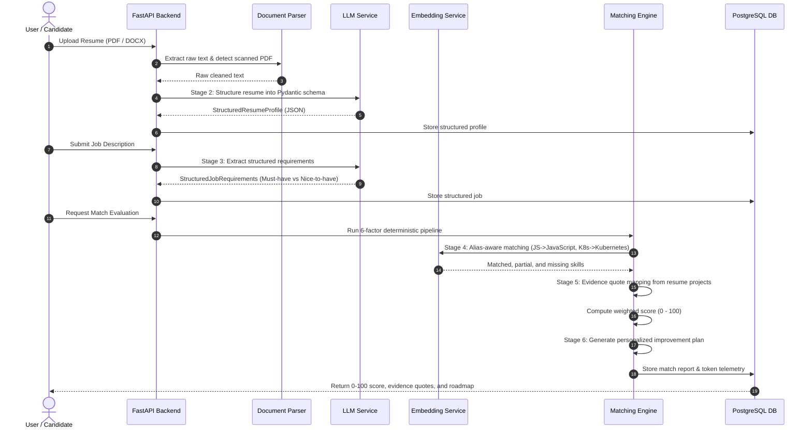
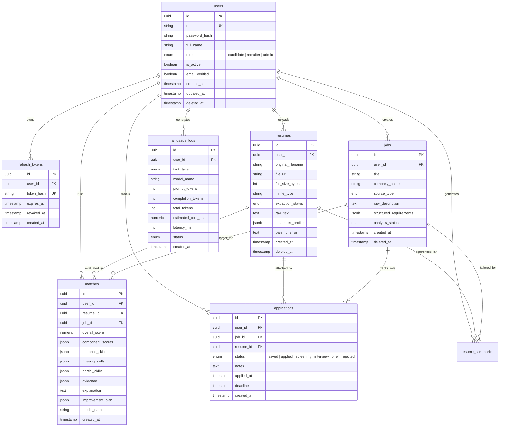

# ResumeFit System Architecture

ResumeFit is an AI-powered resume-to-job matcher and application tracking system engineered with a clean layered architecture, deterministic explainability, and multi-stage LLM evaluation.

---

## 1. High-Level Architecture Overview

```mermaid
flowchart TD
    subgraph Client["Presentation Layer (Client)"]
        UI["Next.js 14 App Router (React, TypeScript, Tailwind CSS)"]
        State["TanStack React Query + React Hook Form + Zod"]
        AuthContext["Auth Context (JWT + Refresh Rotation)"]
    end

    subgraph API_GW["API & Security Layer"]
        FastAPI["FastAPI 0.111+ Backend"]
        RateLimit["Rate Limiter (Sliding Window Redis/Memory)"]
        SecMiddleware["Structured Logging & Global Exception Handlers"]
    end

    subgraph Business["Service Layer (Domain Logic)"]
        AuthSvc["AuthService (bcrypt, JWT rotation)"]
        ResumeSvc["ResumeService (Document Parser, Pydantic Schema)"]
        JobSvc["JobService (Requirement Structuring)"]
        MatchEngine["MatchingEngine (6 Weighted Factors, Deterministic)"]
        SummarySvc["SummaryService (Evidence-Based Synthesis)"]
        AppSvc["ApplicationService (Kanban & Pipeline Tracker)"]
    end

    subgraph Integrations["Integration Layer"]
        Storage["StorageService (Local Filesystem / S3 Adapter)"]
        DocExtract["DocumentParser (PyMuPDF, python-docx, TXT)"]
        LLM["LLMService (OpenAI / Local Heuristic Fallback)"]
        Embed["EmbeddingService (Cosine Similarity, Alias Map)"]
        Email["EmailService (Console Preview / SMTP TLS)"]
    end

    subgraph Data["Persistence & Caching Layer"]
        PG[(PostgreSQL 16 Relational DB)]
        Redis[(Redis 7 In-Memory Cache & Tasks)]
        Filesystem[(Secure File Store /uploads)]
    end

    UI -->|HTTP / REST (JSON)| FastAPI
    FastAPI --> RateLimit
    RateLimit --> SecMiddleware
    SecMiddleware --> Business

    ResumeSvc --> Storage
    ResumeSvc --> DocExtract
    ResumeSvc --> LLM

    JobSvc --> DocExtract
    JobSvc --> LLM

    MatchEngine --> Embed
    MatchEngine --> LLM

    SummarySvc --> LLM
    AuthSvc --> Email

    Business --> PG
    Business --> Redis
    Storage --> Filesystem
```

---

## 2. Multi-Stage AI Matching Pipeline

ResumeFit rejects single-prompt raw matching. Instead, it processes inputs through an explainable, 6-stage pipeline:



---

## 3. Database Entity Relationship Diagram



---

## 4. Deterministic Scoring Model

The final score is computed through an explainable, 6-factor weighted algorithm:

$$\text{Overall Score} = \sum_{i=1}^{6} (w_i \times S_i)$$

Where the default component weights are:
1. **Required Skills ($S_1$)**: 40% weight ($w_1 = 0.40$)
2. **Experience Relevance ($S_2$)**: 20% weight ($w_2 = 0.20$)
3. **Nice-to-Have Skills ($S_3$)**: 15% weight ($w_3 = 0.15$)
4. **Projects & Practical Evidence ($S_4$)**: 10% weight ($w_4 = 0.10$)
5. **Education & Degree Fit ($S_5$)**: 10% weight ($w_5 = 0.10$)
6. **Seniority Alignment ($S_6$)**: 5% weight ($w_6 = 0.05$)

All component scores are normalized from $0.0$ to $100.0$. If a job posting does not require specific years of experience or degree credentials, the candidate is **not penalized** and receives standard baseline scores for those components.
