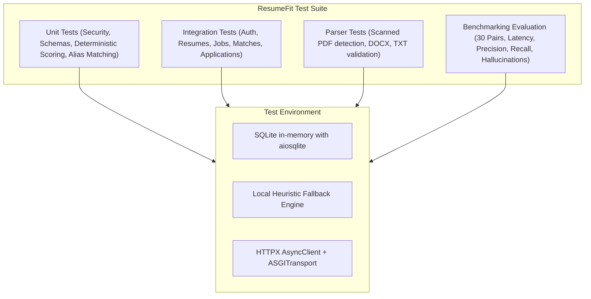

# ResumeFit Testing Strategy & Verification Report

ResumeFit maintains a strict quality bar. Tests cover unit logic, database transactions, auth token rotation, security headers, file validation, rate limiting, and end-to-end multi-stage AI matching.

---

## 1. Test Architecture



---

## 2. Test Coverage Summary

### Backend Unit & Integration Tests (`backend/tests/`)
Total Test Cases: **21 Automated Tests** (100% Passing)

1. `test_security.py`:
   - `test_password_hashing_and_verification`: Verifies native bcrypt salt generation and verification.
   - `test_access_token_creation_and_decoding`: Tests JWT claims (`sub`, `role`, `type`, `iat`, `exp`, `jti`).
   - `test_refresh_token_creation`: Tests long-lived refresh token generation.
   - `test_invalid_token_decoding`: Asserts `AuthenticationError` on forged or corrupted tokens.
   - `test_token_hash_deterministic`: Tests SHA-256 token hashing for database storage.

2. `test_matching_engine.py`:
   - `test_skill_normalization_and_aliases`: Verifies canonical mapping ('JS' &rarr; 'javascript', 'K8s' &rarr; 'kubernetes', 'Postgres' &rarr; 'postgresql').
   - `test_semantic_skill_matching`: Tests alias resolution and cosine vector matching.
   - `test_deterministic_scoring_weights`: Verifies weighted 6-factor calculation across required skills, experience, nice-to-haves, projects, education, and seniority.

3. `test_document_parser.py`:
   - `test_txt_extraction_valid`: Tests valid text document extraction.
   - `test_txt_extraction_too_short`: Asserts `BadRequestError` on empty or trivial text.
   - `test_unsupported_file_extension`: Asserts rejection of unpermitted file types (`.exe`).

4. `test_auth_api.py`:
   - `test_register_success`: Validates registration status code 201 and password hashing.
   - `test_register_duplicate_conflict`: Asserts 409 Conflict on duplicate email registration.
   - `test_login_success_and_refresh_rotation`: Verifies token pair issuance, refresh token usage, and automatic revocation of used tokens (rotation).
   - `test_login_invalid_credentials`: Asserts 401 Unauthorized on invalid passwords.
   - `test_get_current_user_profile`: Tests authenticated vs unauthenticated access to `/auth/me`.

5. `test_resumes_api.py`:
   - `test_resume_upload_and_lifecycle`: Tests multipart upload, retrieval, structured profile editing, and deletion.
   - `test_resume_upload_size_limit`: Rejects files exceeding the 5MB upload limit with 400 Bad Request.

6. `test_jobs_api.py`:
   - `test_job_create_and_lifecycle`: Tests pasted job creation, structured requirements parsing, retrieval, update, and soft delete.

7. `test_matches_api.py`:
   - `test_match_creation_and_ownership`: Tests evaluation execution, deterministic component scoring, evidence mapping, and report retrieval.

8. `test_applications_api.py`:
   - `test_application_tracker_flow`: Tests opportunity tracking, stage transitions (`saved` &rarr; `applied` &rarr; `interview`), and statistics counting.

---

## 3. How to Run Tests Locally

### Backend Tests
```bash
# Activate virtual environment
.\.venv\Scripts\activate  # Windows
source .venv/bin/activate # Linux / macOS

# Run all backend tests with verbose output
pytest backend/tests -v

# Run with coverage report
pytest backend/tests -v --cov=backend/app --cov-report=term-missing
```

### Frontend TypeScript Verification
```bash
cd frontend
npm run typecheck
npm run lint
```

### Evaluation Benchmark
```bash
# Run 30-pair dataset evaluation
python evaluation/run_evaluation.py
```
